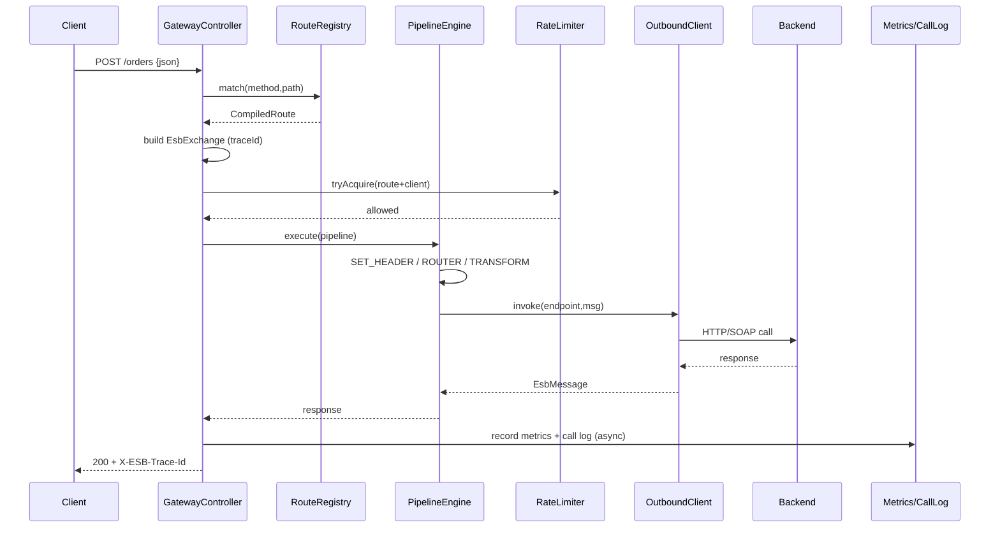
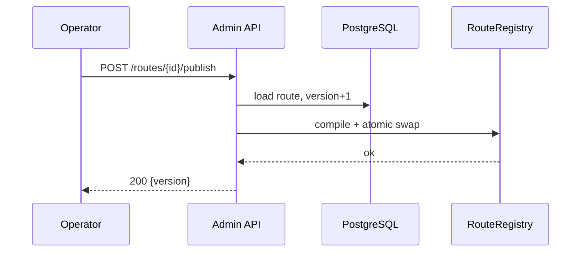

# Design — King ESB Platform

## 1. Architecture Overview

Modular monolith assembled into a single Spring Boot application (`esb-app`). Modules are
Maven modules with a strict one-directional dependency graph; cross-module behavior is wired
through Spring beans implementing SPI interfaces declared in `esb-core`.

```
                    ┌──────────────────────────────────────────────┐
   Client Systems   │                esb-app (Spring Boot)          │
  ┌────────────┐    │                                               │
  │ REST/JSON  │───▶│  ┌──────────────────┐   ┌──────────────────┐  │
  │ SOAP/XML   │───▶│  │ Inbound Gateway  │   │  Admin REST API  │  │
  └────────────┘    │  │  (esb-admin)     │   │   (esb-admin)    │  │
  ┌────────────┐    │  └────────┬─────────┘   └────────┬─────────┘  │
  │ Console SPA│───▶│           │                      │            │
  └────────────┘    │           ▼                      ▼            │
                    │  ┌──────────────────────────────────────────┐ │
                    │  │        esb-core: RouteRegistry           │ │
                    │  │  Exchange · Pipeline · Processor SPI     │ │
                    │  │  Router · LoadBalancer · Expression      │ │
                    │  └───────┬───────────────────────┬──────────┘ │
                    │          │                       │            │
                    │   ┌──────▼──────┐        ┌───────▼────────┐   │
                    │   │ esb-transport│       │ esb-transform  │   │
                    │   │ HTTP / SOAP  │       │ JSON/XML/TPL   │   │
                    │   └──────┬──────┘        └───────┬────────┘   │
                    │          │                       │            │
                    │   ┌──────▼───────────────────────▼────────┐   │
                    │   │  esb-governance: metrics · calllog ·   │   │
                    │   │  rate limit · health                   │   │
                    │   └──────┬───────────────────────┬────────┘   │
                    └──────────┼───────────────────────┼────────────┘
                               ▼                       ▼
                        ┌────────────┐         ┌────────────┐
                        │ PostgreSQL │         │   Redis    │
                        └────────────┘         └────────────┘
```

## 2. Module Dependency Graph

```
esb-common  ◀── esb-core ◀── esb-transport
   ▲              ▲    ▲
   │              │    └──◀ esb-transform
   │              └────◀ esb-governance
   └───────────────────────◀ esb-admin ◀── esb-app (bootable)
```

- `esb-common` — shared value objects, error model, JSON helpers, constants. No Spring dependency.
- `esb-core` — route model, registry, pipeline engine, Processor SPI, expression evaluator, router/load balancer. Spring context (DI) allowed.
- `esb-transport` — `OutboundClient` SPI implementations (HTTP, SOAP) and SOAP parsing. Depends on core SPI.
- `esb-transform` — `Transformer` SPI implementations. Depends on core SPI + common.
- `esb-governance` — metrics decorator, call-log service, rate limiter (Redis + in-memory fallback), health indicators.
- `esb-admin` — JPA entities/repositories, Flyway, admin REST controllers, JWT security, inbound gateway controller, route-config persistence + mapping.
- `esb-app` — `@SpringBootApplication` bootstrap, `application.yml`, static console assets, Docker/compose.

**Rule:** no module depends on `esb-app`; `esb-core` never depends on admin/transport/transform/governance implementations (only SPI).

## 3. Core Domain Model (`esb-core`)

### 3.1 Message & Exchange

```java
// esb-core
public final class EsbMessage {
    private final byte[] body;                     // raw bytes
    private final Map<String,List<String>> headers; // case-insensitive
    private String contentType;
    // accessors: body(), bodyAsString(), headers(), header(name), setHeader(...), removeHeader(...)
}

public enum ExchangeStatus { OK, ERROR, FILTERED, RATE_LIMITED }

public final class EsbExchange {
    private final String traceId;                  // UUID
    private final String routeId;
    private final String method;
    private final String path;
    private final Map<String, String> query;
    private EsbMessage request;
    private EsbMessage response;
    private ExchangeStatus status;
    private Throwable error;
    private final Instant startTime;
    private long durationMillis;
    private final Map<String,Object> variables;    // pipeline scratch space
}
```

### 3.2 Route & Pipeline Definition

```java
public record RouteDefinition(
    String id,
    String name,
    String description,
    String path,          // e.g. /orders/**
    String method,        // GET|POST|PUT|DELETE|* 
    int priority,
    boolean enabled,
    String apiKey,        // optional gateway key
    RateLimitConfig rateLimit,   // nullable
    List<ProcessorDefinition> pipeline,
    ErrorHandlerConfig errorHandler  // nullable -> defaults
) {}

public record ProcessorDefinition(
    String id,             // unique within route
    ProcessorType type,    // SET_HEADER|REMOVE_HEADER|LOG|FILTER|ROUTER|TRANSFORM|SERVICE_CALL|RATE_LIMIT
    Map<String,Object> config  // type-specific
) {}

public enum ProcessorType { SET_HEADER, REMOVE_HEADER, LOG, FILTER, ROUTER, TRANSFORM, SERVICE_CALL, RATE_LIMIT }

public record RateLimitConfig(int requestsPerWindow, int windowSeconds, String keyBy) {}
```

### 3.3 Processor SPI

```java
public interface Processor {
    ProcessorType type();
    void process(EsbExchange exchange, ProcessorDefinition def, PipelineContext ctx) throws EsbException;
}
```

`PipelineContext` gives access to: `RouteRegistry`, `OutboundClientRegistry`, `TransformerRegistry`,
expression evaluator, and (for SERVICE_CALL/ROUTER) the target routing logic.

The engine iterates processors in order, catching `EsbException`, and on error runs the
route `errorHandler` (strategy `DEFAULT` → fail exchange, `CONTINUE` → keep last response).

### 3.4 Routing & Load Balancing

```java
public record TargetDefinition(
    List<EndpointDefinition> endpoints,
    LoadBalanceStrategy strategy,   // ROUND_ROBIN | RANDOM | FAILOVER
    List<PredicateDefinition> when, // content-based conditions (empty = default/match-all)
    boolean isDefault
) {}

public record EndpointDefinition(
    String id, String uri, EndpointType type, // HTTP | SOAP
    String method, Map<String,String> headers,
    int connectTimeoutMs, int readTimeoutMs, int retryCount, String soapAction
) {}

public record PredicateDefinition(String source, String operator, String value) {}
// source: header:<name> | path | method | query:<name> | body:<jsonpath-lite>
// operator: EQ | NE | CONTAINS | STARTS_WITH | REGEX | EXISTS
```

`ContentBasedRouter` evaluates each target's `when` predicates (all must match); first match wins;
otherwise the `isDefault` target. `LoadBalancer` selects an endpoint per strategy
(round-robin uses an `AtomicInteger` per target; FAILOVER moves to the next endpoint on error).

### 3.5 Expression Evaluation

`ExpressionContext` exposes `headers`, `body`, `path`, `method`, `query`.
A lightweight resolver supports `${...}` placeholders:

| Expression | Meaning |
|------------|---------|
| `${headers.X-Tenant}` | header value |
| `${body.field.sub}` | JSON dot-path into parsed body |
| `${path}` `${method}` | request path/method |
| `${query.q}` | query param |
| `${body}` | raw body string |

Predicates reuse the same resolver for their `source`/`value`.

## 4. Transport (`esb-transport`)

```java
public interface OutboundClient {
    EndpointType supports();
    EsbMessage invoke(EndpointDefinition endpoint, EsbMessage request, EsbExchange exchange) throws EsbException;
}
```

- **HttpOutboundClient** — uses Spring `RestClient` (or `java.net.http.HttpClient`) with connect/read
  timeouts; retries on `5xx`/I/O error with exponential backoff (`retryCount`, base 200ms). Maps
  response status/headers/body back into an `EsbMessage`; copies `Exchange.status` based on `2xx`.
- **SoapOutboundClient** — wraps body in a SOAP 1.1 envelope, sends `text/xml`, sets `SOAPAction`;
  parses the response envelope and extracts `Body`; SOAP `Fault` → `EsbException(GATEWAY_ERROR)` with fault code.
- **SoapRequestParser** (inbound helper) — detects SOAP by content type, extracts `Body` and `SOAPAction`.

## 5. Transformation (`esb-transform`)

```java
public interface Transformer {
    TransformType type();
    EsbMessage transform(TransformerContext ctx, EsbMessage in, Map<String,Object> config) throws EsbException;
}
public enum TransformType { JSON_TO_XML, XML_TO_JSON, TEMPLATE, FIELD_MAP }
```

- **JsonXmlTransformer** — Jackson `ObjectMapper` + `jackson-dataformat-xml`; JSON→XML uses `rootName`;
  XML→JSON parses into `JsonNode`.
- **TemplateTransformer** — renders a template string, replacing `${...}` using the expression resolver
  (body/header/query/path). Output content type configured (default `application/json`).
- **FieldMapTransformer** — config `mappings: [{target, source, default, required}]`; source uses dot-path;
  missing required → `TRANSFORM_ERROR`; output is a JSON object.
- Content type header updated on success.

## 6. Governance (`esb-governance`)

- **Metrics**: `EsbMetrics` wraps Micrometer `MeterRegistry`; records
  `esb.exchange.duration` (timer) tagged `route,status`, and counters `esb.exchange.total` / `esb.exchange.errors`.
  Registered with a Prometheus registry when `management.metrics.export.prometheus` (default) applies.
- **CallLogService**: `@Async` persist of `CallLogEntity`; bounded thread pool; failures are logged and swallowed.
- **RateLimiter** SPI: `boolean tryAcquire(String key, int limit, int windowSeconds)`.
  - `RedisRateLimiter` — fixed-window `INCR` + `EXPIRE` (Lettuce via Spring Data Redis).
  - `InMemoryRateLimiter` — fallback when Redis is down (Caffeine/`ConcurrentHashMap` sliding window).
  - Wrapper `ResilientRateLimiter` catches Redis errors and delegates to in-memory (fail-open for limiter).
- **Health**: `RouteRegistryHealthIndicator`, `RedisHealthIndicator` (Spring's), DB health via Spring JDBC.

## 7. Admin Module (`esb-admin`)

### 7.1 Persistence (JPA + Flyway)

**Tables**

| Table | Columns |
|-------|---------|
| `esb_route` | id (uuid pk), name (unique), description, path, method, priority, enabled (bool), api_key, config_json (jsonb/text), version (int), created_by, created_at, updated_by, updated_at |
| `esb_call_log` | id (bigserial pk), trace_id, route_id, method, path, status, http_status, duration_ms, client_ip, error_code, error_message, created_at |
| `esb_user` | id (uuid pk), username (unique), password_hash, roles (csv), enabled (bool), created_at, updated_at |
| `esb_audit_log` | id (bigserial pk), actor, action, target, detail, created_at |

`config_json` holds the serialized `RouteDefinition` (pipeline, targets, rateLimit) so schema evolution
doesn't require DDL changes; indexed columns (`name`, `path`, `enabled`) support fast lookup.

Migrations: `V1__init.sql` (all tables), `V2__seed_admin.sql` (admin user inserted by app bootstrap,
not SQL, to avoid plaintext hash in source → instead app seeds if missing).

### 7.2 Admin REST API

Base path `/admin/api/v1`.

| Method | Path | Role | Description |
|--------|------|------|-------------|
| POST | `/auth/login` | public | Login → `{token, roles, expiresIn}` |
| GET | `/auth/me` | any auth | Current user + roles |
| GET | `/routes` | VIEWER+ | List routes (paged, filter enabled) |
| POST | `/routes` | OPERATOR+ | Create route |
| GET | `/routes/{id}` | VIEWER+ | Get route |
| PUT | `/routes/{id}` | OPERATOR+ | Update route (creates new version) |
| PUT | `/routes/{id}/status` | OPERATOR+ | Enable/disable |
| POST | `/routes/{id}/publish` | OPERATOR+ | Compile into runtime registry |
| DELETE | `/routes/{id}` | ADMIN | Delete route |
| GET | `/logs` | VIEWER+ | Query call logs (filter routeId/status/from/to, page) |
| GET | `/metrics/summary` | VIEWER+ | Aggregated counts + avg latency + error rate |
| GET | `/users` | ADMIN | List users |
| POST | `/users` | ADMIN | Create user |

**Error body** (uniform):
```json
{ "error": { "code": "VALIDATION_ERROR", "message": "...", "details": [{"field":"path","message":"..."}] , "traceId": "..." } }
```

### 7.3 Inbound Gateway

`EsbGatewayController` mapped to `/**` (lowest precedence, excluded from security for non-admin paths).
Flow: resolve route via `RouteMatcher` → build `EsbExchange` → check API key → check rate limit →
execute pipeline → return response. Admin/actuator/console/static paths are excluded.

### 7.4 Security

- `JwtService` — HS256 signed tokens (`sub`, `roles`, `exp`), secret from `esb.security.jwt-secret`.
- `JwtAuthFilter` — validates `Authorization: Bearer`, populates `SecurityContext`.
- `SecurityConfig` — stateless; `/admin/api/v1/auth/login` public; `/admin/api/v1/**` authenticated with
  method-level `@PreAuthorize`; `/**` (gateway), `/console/**`, `/actuator/health`, `/actuator/prometheus` permitted.
- Bootstrap seeder creates `admin` user (role ADMIN) from `esb.security.admin-password` if absent.

### 7.5 Route Runtime Sync

`RoutePublishService` persists then calls `RouteRegistry.publish(RouteDefinition)`. On startup,
`RouteRegistry` loads all enabled routes from DB. Registry is an immutable-map holder updated atomically
(`AtomicReference<Map<String, CompiledRoute>>`).

## 8. Admin Console (`esb-app` static)

Dependency-free SPA under `/console/`: `index.html`, `app.js`, `styles.css`.
Views: Login, Dashboard (metrics cards + per-route table), Routes (list + JSON editor + enable/publish/delete),
Logs (table + filter). Uses `fetch` against `/admin/api/v1`; stores JWT in `localStorage`.

## 9. Sequence Diagrams

### 9.1 Inbound gateway → backend



### 9.2 Route publish / hot reload



## 10. Security Considerations

- Auth: JWT HS256, expiry default 8h; secret ≥ 32 bytes from env.
- Authorization: `@PreAuthorize` role checks (ADMIN/OPERATOR/VIEWER).
- Passwords: BCrypt (strength 10).
- Gateway: optional per-route API key (`X-ESB-Api-Key`).
- Input: route JSON validated server-side; template/predicate expressions are sandboxed to the documented resolver (no arbitrary code).
- Rate limiting: per route + client (IP or API key or configurable header).
- Secrets: never in source; provided via env (`ESB_JWT_SECRET`, `ESB_ADMIN_PASSWORD`); dev defaults only for the `dev` profile.

## 11. Performance Considerations

- Target gateway overhead < 20 ms (p95) excluding backend.
- `RouteMatcher` uses a pre-sorted list (priority desc) with exact-then-wildcard match; exact path → O(1) map lookup.
- Call logging is async and never blocks the response path.
- HTTP outbound uses pooled connections and bounded timeouts.
- Registry reads are lock-free (`AtomicReference`).

## 12. Alternatives Considered

### A1: Apache Camel / Spring Integration as the engine
**Pros**: mature EIP library, many components. **Cons**: large dependency surface, harder to expose a
DB-driven dynamic route model and custom console; learning curve. **Decision**: not chosen — a purpose-built
lightweight pipeline engine gives full control over the dynamic, DB-driven model required here.

### A2: Microservices per capability
**Pros**: independent scaling. **Cons**: overkill for a 0→1 single-node MVP; operational complexity.
**Decision**: not chosen — modular monolith with clean boundaries, horizontal scaling deferred.

### A3: Node/Vite SPA console
**Pros**: richer UI tooling. **Cons**: runtime/build toolchain dependency, heavier deploy.
**Decision**: not chosen for MVP — static dependency-free SPA served by Spring Boot.

### A4: XML config (Spring XML / route XML files)
**Pros**: familiar to legacy ESB users. **Cons**: poor dynamic editing from a web console; no versioning.
**Decision**: not chosen — JSON route definitions stored in DB with versioning.
